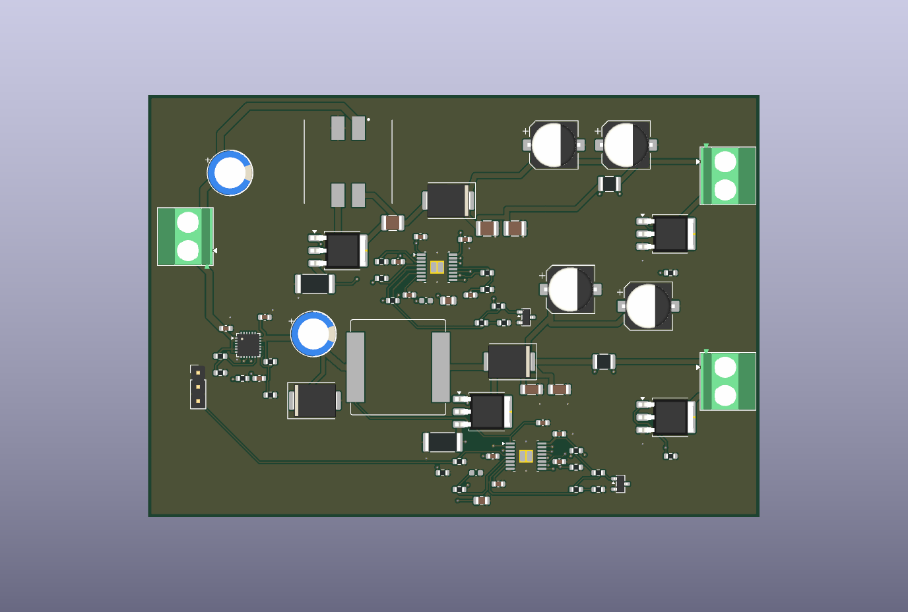

# Dual-channel UV curing LED driver PCB

A 12 V constant-current driver with two independently PWM-controlled UV outputs. Rev C1 is a routed 110 × 76 mm, four-layer PCB using commercial TI TPS92691 controllers and external power stages. This project closes at the design and simulation stage. Hardware fabrication, measured performance, and curing validation are pending.

| Channel | Power stage | Rev C1 nominal current |
| --- | --- | ---: |
| 365 nm | SEPIC with a 1:1 coupled inductor | 579 mA |
| 405 nm | Boost with upstream TPS26630 eFuse | 501 mA |

*KiCad render. Parts without 3D models appear as footprints.*

## Design decisions

- The 365 nm supply and load voltage ranges call for step-up and step-down operation. Switched modeling showed a growing oscillation with separate inductors and supported selecting the coupled-inductor design.
- The 405 nm output targets a 32–34 V load. Its boost stage includes an eFuse to disconnect the input during a sustained fault.
- Rev C1 uses lower current settings for initial dummy-load bring-up. Modeling also supported increasing the 405 nm soft-start capacitor to 220 nF.

## Files and verification

- [KiCad project](uv_driver/rev_c/UV_DRIVER.kicad_pro), [schematic](uv_driver/rev_c/UV_DRIVER.kicad_sch), and [routed PCB](uv_driver/rev_c/UV_DRIVER.kicad_pcb)
- [Fabrication quote package](results/UV_DRIVER_RevC1_QUOTE_ONLY.zip) with Gerbers, drills, BOM, placements, and KiCad reports
- [Prototype engineering notes](docs/UV_REV_C1_PROTOTYPE.md) and [interview walkthrough](DEMO.md)

| Check | Result |
| --- | --- |
| KiCad 10.0.3 | Zero ERC or DRC violations, unrouted connections, or schematic-to-PCB mismatches |
| 365 nm switched stability screen | No growing mode in 128 modeled operating conditions |
| 405 nm nominal-current transient model | Up to 0.524 A at startup and 0.547 A at PWM restart |

From the project root, run the following with Python 3.9 or later. The SEPIC model requires NumPy.

    python3 scripts/check_uv_sepic_switching.py
    python3 scripts/check_uv_405_restart.py --prototype

The earlier [buck simulation study](docs/LEGACY_BUCK_STUDY.md) and the [development tracker](CODEX_PLAN.md) document the project history. The [bench worksheet](docs/UV_405_BENCH.md) records how the design can be tested later.
