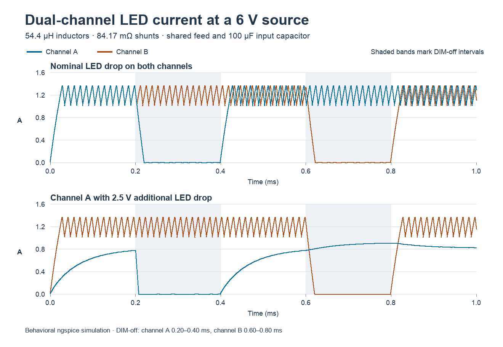

# Dual-channel hysteretic buck LED driver

> Earlier behavioral study retained as project history. See the [final UV driver PCB](../README.md).

A behavioral SPICE model of a two-channel constant-current LED driver. The design targets a 6–30 V input and about 1.2 A per channel with the modeled single LED. Each channel has an independent DIM input. The simulations demonstrate current regulation, PWM dimming, and loss of regulation when the LED load needs more voltage than the supply can provide.

## How it works

Each channel measures the drop across an 83.33 mΩ high-side sense resistor. The low-side switch turns on below 85 mV and turns off above 115 mV, corresponding to nominal current thresholds of 1.02 A and 1.38 A. During the off interval, the inductor continues to drive current through the LED and freewheel diode. Pulling DIM below 0.3 V forces the switch off and current decays through the freewheel path.

The two channels reuse [one SPICE subcircuit](../spice/channel.inc). The regression exercises a shared input, including representative feed impedance and input decoupling. The earlier PT4115 schematic prototype is archived locally. The circuit being verified here is defined by the files in `spice/`.

## Run the simulation checks

From the project directory:

```sh
python3 scripts/check_sim.py
```

Use Python 3.9 or later. The script uses standalone ngspice on your PATH, or the shared library at the default KiCad install location on macOS. For a different shared library location, pass `--library /absolute/path/to/library`. The shared-library path was verified on macOS arm64 with ngspice 44.2. The standalone backend still needs a clean-environment check.

The suite checks current regulation at 6, 12, 24 and 30 V, independent DIM shutdown and recovery, PWM at 1 kHz, component tolerances and low-input dropout. It exits with an error if a simulation fails or a checked value falls outside the expected range.

Regenerate the numerical results and waveform figure. Figure export requires Pillow 10.1 or later. Install it with `python3 -m pip install 'Pillow>=10.1'` if it is unavailable.

```sh
python3 scripts/check_sim.py --export-dir results
```

This writes both waveform CSVs, the combined 6 V case summary, and the PNG below.

## Representative results

- **Supply sweep:** One channel averaged 1.1992–1.2013 A across the four nominal input voltages.
- **Shared input:** With the modeled feed and decoupling network, disabling one channel shifted the other channel’s average by at most 6.0 mA.
- **PWM at 12 V:** 10%, 50% and 90% duty at 1 kHz produced 0.131 A, 0.609 A and 1.087 A average current.
- **Dropout at 6 V:** Adding 2.5 V of series drop to channel A’s LED model reduced its early average to 0.612–0.711 A across four passive tolerance combinations. Channel B still averaged 1.188–1.214 A over the same interval.



The shaded intervals show each channel’s DIM command going low. In the top panel the traces overlap before the first DIM-off interval because both channels start together with identical parameters.

## Model scope

The controller and DIM threshold are behavioral. Diode, switch and supply-network values are assumptions. Real load headroom, sense accuracy, propagation delay, switch stress and process variation require device or hardware evidence. The project has no confirmed foundry PDK, transistor-level signoff or fabricated hardware. The [development tracker](../CODEX_PLAN.md) records the remaining decisions and tests.
